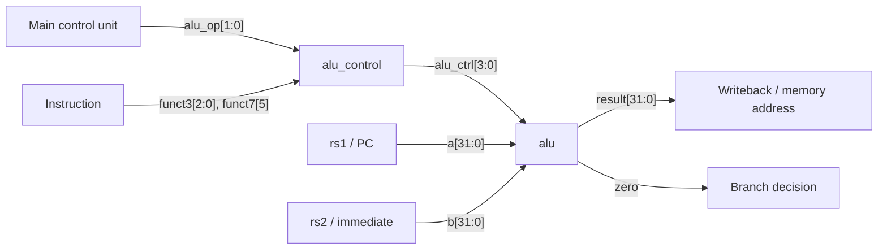
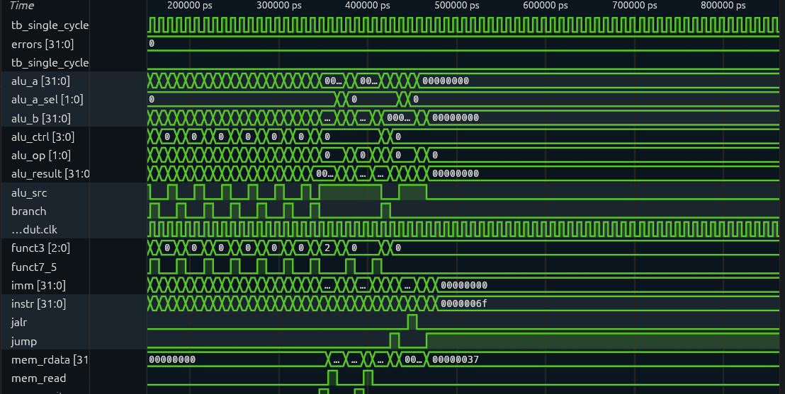
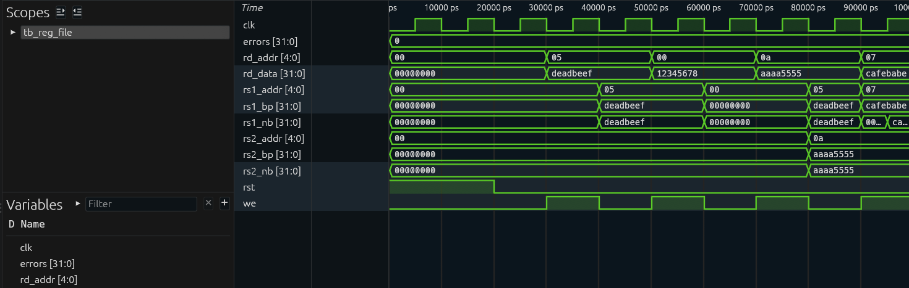

# RV32I ALU (Verilog)

The Arithmetic Logic Unit (ALU) and ALU control unit of a RISC-V **RV32I** CPU, written in
synthesizable Verilog. They are the execute-stage core of a larger CPU project (single-cycle and
5-stage pipelined), where they handle every integer arithmetic, logic, shift, compare and
address calculation.

## Contents

- [Files](#files)
- [How the two modules fit together](#how-the-two-modules-fit-together)
- [`alu` module](#alu-module)
- [`alu_control` module](#alu_control-module)
- [Instruction-to-operation mapping](#instruction-to-operation-mapping)
- [Verification](#verification)
- [Results](#results)
- [Building and simulating](#building-and-simulating)

## Files

| File | Description |
|------|-------------|
| `alu.v` | 32-bit combinational ALU with a `zero` flag |
| `alu_control.v` | Decodes `alu_op`, `funct3` and `funct7[5]` into a 4-bit `alu_ctrl` |
| `results/` | Waveform screenshots from simulating the CPU |

## How the two modules fit together

The main control unit decodes the opcode into a 2-bit `alu_op` that says what kind of
instruction it is. `alu_control` combines that with the instruction's `funct3` and `funct7[5]`
(bit 30) to choose the exact operation, and the ALU carries it out.



## `alu` module

### Ports

| Port | Direction | Width | Description |
|------|-----------|-------|-------------|
| `a` | input | 32 | First operand (usually `rs1`, or the PC for AUIPC/JAL) |
| `b` | input | 32 | Second operand (`rs2` or the immediate) |
| `alu_ctrl` | input | 4 | Operation select (see table below) |
| `result` | output | 32 | Operation result |
| `zero` | output | 1 | High when `result == 0` |

### Operations

| `alu_ctrl` | Operation | Result |
|-----------|-----------|--------|
| `0000` | ADD  | `a + b` |
| `0001` | SUB  | `a - b` |
| `0010` | AND  | `a & b` |
| `0011` | OR   | `a \| b` |
| `0100` | XOR  | `a ^ b` |
| `0101` | SLL  | `a << b[4:0]` |
| `0110` | SRL  | `a >> b[4:0]` (logical, fills with 0) |
| `0111` | SRA  | `a >>> b[4:0]` (arithmetic, copies the sign bit) |
| `1000` | SLT  | `1` if `a < b` (signed), else `0` |
| `1001` | SLTU | `1` if `a < b` (unsigned), else `0` |
| others | —    | `0` |

### Design notes

- **Purely combinational.** One `always @(*)` block with a `case`; no clock or state.
- **Shift amount uses only `b[4:0]`.** RV32I shifts by 0–31, so upper bits are ignored, as the spec requires.
- **Signed vs unsigned** is handled with `$signed()` for SRA and SLT; SLTU compares raw unsigned values.
- **`zero` flag.** Branches send `alu_op = 01`, so the ALU subtracts and `zero` tells whether `rs1 == rs2`.
- **Safe default.** Unused `alu_ctrl` codes return `0` and don't infer latches.

## `alu_control` module

### Ports

| Port | Direction | Width | Description |
|------|-----------|-------|-------------|
| `alu_op` | input | 2 | Instruction class from the main control unit |
| `funct3` | input | 3 | Instruction bits `[14:12]` |
| `funct7_5` | input | 1 | Instruction bit `[30]` |
| `alu_ctrl` | output | 4 | Operation for the ALU |

### Decoding

| `alu_op` | Used for | `alu_ctrl` |
|----------|----------|------------|
| `00` | load, store, JALR, LUI, AUIPC | ADD |
| `01` | branches | SUB |
| `10` | R-type | from `funct3`; `funct7[5]` selects SUB vs ADD and SRA vs SRL |
| `11` | I-type ALU | from `funct3`; `funct7[5]` selects SRAI vs SRLI |

For I-type instructions, bit 30 is part of the immediate. That's why `funct7[5]` only turns ADD
into SUB when `alu_op = 10` (R-type), so `ADDI` with a negative immediate is never decoded as SUB.

## Instruction-to-operation mapping

| Instruction(s) | `alu_op` | `funct3` | `funct7[5]` | ALU operation |
|----------------|----------|----------|-------------|---------------|
| `ADD` / `ADDI` | 10 / 11 | 000 | 0 / – | ADD |
| `SUB` | 10 | 000 | 1 | SUB |
| `SLL` / `SLLI` | 10 / 11 | 001 | 0 | SLL |
| `SLT` / `SLTI` | 10 / 11 | 010 | – | SLT |
| `SLTU` / `SLTIU` | 10 / 11 | 011 | – | SLTU |
| `XOR` / `XORI` | 10 / 11 | 100 | – | XOR |
| `SRL` / `SRLI` | 10 / 11 | 101 | 0 | SRL |
| `SRA` / `SRAI` | 10 / 11 | 101 | 1 | SRA |
| `OR` / `ORI` | 10 / 11 | 110 | – | OR |
| `AND` / `ANDI` | 10 / 11 | 111 | – | AND |
| `LW`, `SW`, `JALR`, `LUI`, `AUIPC` | 00 | – | – | ADD (address / value) |
| `BEQ`, `BNE`, ... | 01 | – | – | SUB (compare) |

## Verification

The ALU was tested with a self-checking Icarus Verilog testbench that drives each operation
and compares the result with the expected value:

| Operation | `a` | `b` | Expected |
|-----------|-----|-----|----------|
| ADD  | `5` | `3` | `8` |
| SUB  | `5` | `3` | `2` |
| AND  | `0xF0F0` | `0xFF00` | `0xF000` |
| OR   | `0xF0F0` | `0x0F0F` | `0xFFFF` |
| XOR  | `0xFFFF` | `0x0F0F` | `0xF0F0` |
| SLL  | `1` | `4` | `16` |
| SRL  | `0x80000000` | `4` | `0x08000000` |
| SRA  | `0x80000000` | `4` | `0xF8000000` |
| SLT  | `0xFFFFFFFF` (-1) | `1` | `1` |
| SLTU | `0xFFFFFFFF` | `1` | `0` |

The SRL/SRA and SLT/SLTU pairs use the same inputs so they check the signed and unsigned paths
against each other.

## Results

### Single-cycle CPU running a test program

The ALU and ALU control running inside the single-cycle RV32I CPU (`tb_single_cycle`).
The trace shows `alu_op` and `funct3` being decoded into `alu_ctrl`, the operands `alu_a` and
`alu_b`, and `alu_result` changing on every instruction. Loads and stores (`mem_read` /
`mem_write`) use the ALU for address calculation, and `jump` / `jalr` pulse near the end.
The program finishes on the halt instruction `0x0000006F` (`jal x0, 0`), and **`errors` stays at
`0`** the whole run.



### Register file test

The register file that supplies the ALU's operands (`tb_reg_file`). It's tested in two
versions: with write-through bypass (`rs1_bp`, `rs2_bp`) and without (`rs1_nb`, `rs2_nb`).
The waveform shows:

- `0xDEADBEEF` written to `x5` and read back
- a write of `0x12345678` to `x0` being ignored (`x0` still reads `0x00000000`)
- `0xAAAA5555` written to `x10` and read on port 2 while port 1 reads `x5`
- `0xCAFEBABE` written to `x7`: the bypass version returns it in the same cycle, while the
  non-bypass version only shows it after the clock edge

**`errors` stays at `0`.**



## Building and simulating

Requires [Icarus Verilog](https://steveicarus.github.io/iverilog/). [GTKWave](https://gtkwave.sourceforge.net/)
or [Surfer](https://surfer-project.org/) can be used to view waveforms.

```sh
# Check that both modules compile
iverilog -Wall -o alu_check alu.v alu_control.v

# With a testbench (for example tb_alu.v)
iverilog -o alu_sim tb_alu.v alu.v && vvp alu_sim
gtkwave alu.vcd
```
